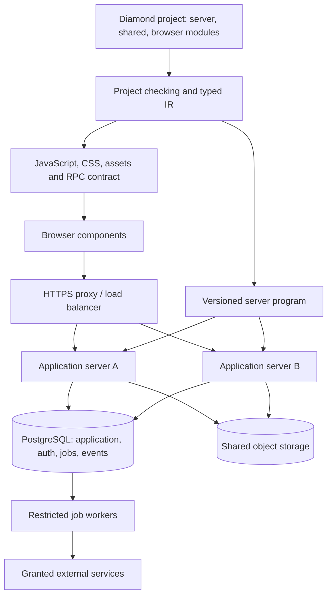

# Feature: Diamond general web application platform

## Summary

Expand Diamond's completed 0.6.0 interpreted MVP into a platform for general web applications with a reactive frontend authored in Diamond, PostgreSQL, and multiple application servers. Deliver working breadth first, connect a real application early, then complete semantics, exercise failures, and finish developer experience and performance.

**Status:** W1–W6 complete within their documented development profiles, 22 October 2026; W7–W10 remain planned. Diamond 0.12.0 retains the bounded [W1 profile](../docs/projects.md) and [W2 connected development profile](../docs/connected-apps.md), and adds the [W3 reactive frontend](../docs/reactive-apps.md), with [W3 evidence](../verification/web_three_results.md). W4 adds [relational storage and scoped authorization](../docs/relational-apps.md), with [W4 evidence](../verification/web_four_results.md). W5 adds [accounts and explicit APIs](../docs/accounts-and-apis.md), with [W5 evidence](../verification/web_five_results.md). W6 adds [private files and typed integrations](../docs/files-and-integrations.md), with [W6 evidence](../verification/web_six_results.md). The unchecked acceptance criteria below remain full-release gates; these increments do not satisfy them in full or imply production readiness.

The user selected all three release targets: a full reactive Diamond frontend; PostgreSQL and multiple application servers from the first release; and accounts, permissions, APIs, uploads, outbound HTTP, and durable jobs. The user also selected MIT licensing and publication at https://github.com/Corvidae-Coding-Projects/Diamond using SSH. Publication of this plan does not authorize deploying infrastructure or beginning implementation automatically.

The existing [MVP plan](../IMPLEMENTATION_PLAN.md) and [completion evidence](../CHECKPOINTS.md) remain historical records for checkpoints one through six. This expansion uses **W1–W10**. The broader [language design](../design.md) remains the architectural direction; this plan implements a specified subset and defers native compilation, tracing GC, and other features listed below.

## Requirements

- REQ-1: Preserve the current checked-program boundary, default-deny policies, explicit host grants, GET/HEAD effect restrictions, and confirmed/aborted/unknown transaction outcomes. Retain the existing single-file examples and native APIs, or provide an explicitly documented versioned migration for any incompatible change.
- REQ-2: Support multi-file applications with server, browser, and shared modules; deterministic resolution; public interfaces; and transitive effect budgets. Imports grant no authority. Build a server artifact, browser assets, and a versioned contract manifest from one project.
- REQ-3: Compile reactive components written in Diamond to JavaScript: local state, derived values, event handlers, typed properties, conditional and keyed-list rendering, forms, client navigation, and asynchronous server calls. Provide server rendering and hydration with defined lifecycle and cleanup behavior.
- REQ-4: Preserve shared language semantics across Rust evaluation and JavaScript execution, including checked signed 64-bit integers, Unicode scalar text lengths, nominal IDs, enums, Option/Result, and explicit errors. Add typed application/adapter errors, timestamps/durations, fixed-scale decimal values with explicit rounding, and bounded text/list utilities.
- REQ-5: Enforce the browser/server boundary in compilation, artifact generation, serialization, and server dispatch. Generated RPC and JSON APIs accept only declared wire-safe types and expose only explicitly exported operations. Client state never supplies verified identity or authority.
- REQ-6: Provide concurrent HTTP serving with typed path/query/body decoding, JSON and forms, controlled response headers/statuses, binary and streaming bodies, deadlines, cancellation, backpressure, configurable quotas, and an explicit verified public-origin/proxy configuration.
- REQ-7: Provide a PostgreSQL adapter with bounded connection pools, typed schema mappings, constraints/indexes, protected CRUD, ordered cursor pagination, relationships, bounded joins, and authorized counts/aggregates. Keep SQLite available for the existing development subset and state adapter differences explicitly.
- REQ-8: Support workspace/project membership and resource relationships in policies with explicit lookup authority, cycle rejection, bounded execution, SQL/reference equivalence, and defined revocation/concurrency behavior. Enforce policies on every protected operation and every base relation involved in a query.
- REQ-9: Provide versioned migrations with compatibility metadata, additive changes, resumable backfills, serialized migration execution, and guarded destructive changes. Preserve transaction uncertainty and forbid implicit replay of external effects.
- REQ-10: Provide shared account/session infrastructure for multiple application servers: provisioning, optional registration, verification/invitations, password change/recovery, logout/revocation, scoped API credentials, shared rate limits, and account disablement. Registration defaults to disabled; applications explicitly choose their enrollment policy.
- REQ-11: Provide standard CSS, compiled component templates, validated asset references, hashed static assets, accessible form/layout primitives, and safe rendering of external content. Browser runtime code comes from Diamond compilation; third-party JavaScript integration is an explicit trusted boundary.
- REQ-12: Provide shared upload/blob storage with opaque handles, streaming quotas, ownership and read/write policies, private defaults, atomic publication of completed objects, safe downloads, and bounded orphan cleanup. Application-server local disks are never the sole durable shared store.
- REQ-13: Provide destination-scoped outbound HTTP, typed request/response decoding, secret-consuming adapters, deadlines, redirect/destination enforcement, and explicit retry/idempotency contracts. Requests to private networks require separately granted destination authority.
- REQ-14: Provide durable jobs and a transactional outbox, with named checked handlers, serializable payloads, fresh restricted execution authority, leases, bounded retries, cancellation, and recovery after worker/process failure. State the at-least-once execution contract and require deduplication where external effects may repeat.
- REQ-15: Provide typed server events and WebSocket endpoints with origin checks, connection-scoped authority, per-operation/delivery policy checks, bounded buffers, cleanup, and expiration/revocation across application servers.
- REQ-16: Allow a small set of trusted Rust adapters to expose typed operations with declared effects, limits, errors, and transaction behavior. Integrate existing tools such as Git through narrow bindings; implement neither a Git replacement nor an unrestricted shell API.
- REQ-17: Operate at least two application servers and two workers with shared durable state, no session-affinity requirement, coordinated deployment versions, health/readiness, graceful draining, redacted diagnostics, metrics, audit events, and tested backup/restore.
- REQ-18: Provide project scaffolding, checking, building, development serving, migration commands, deployment validation, and a documented installation-to-application path. Preserve useful source locations across modules and generated browser code.
- REQ-19: Demonstrate generality through two applications with their business logic in Diamond: a workspace tracker using membership, issues, comments, attachments, and jobs; and a publishing/catalog application using public/private content, typed APIs, and a controlled external integration.
- REQ-20: Verify each increment through real CLI, browser, network, PostgreSQL, storage, and worker interfaces. Preserve reproducible failures, independent state observations, coverage gaps, final artifact hashes, and before/after regression evidence. Complete a broad adversarial and distributed-failure pass before release.

## Acceptance Criteria

These are future release gates, not reports of passing tests. Each gate records its exact supported configuration and observations.

- [ ] AC-1 (REQ-1): All existing examples and the current checkpoint-six/red-team replay campaigns pass on the compatibility profile. Missing grants/policies, transitive GET writes, caught transaction failures, and unknown outcomes retain their documented behavior. Intentional adapter differences have explicit storage contracts and current-source replays; supporting deployed old application versions is not required before users exist.
- [ ] AC-2 (REQ-2): Build a project containing server, shared, and browser modules from an empty installation. Reject cycles in the initial acyclic module graph, ambiguous names, out-of-root imports, undeclared effects, and browser imports of server modules. Identical inputs produce identical first-party artifact hashes on the qualified toolchain.
- [ ] AC-3 (REQ-3): In real browsers, exercise state updates, computed values, keyed insert/reorder/delete, nested components, form errors, loading states, back/forward navigation, and mount/unmount. Hydrate server-rendered pages without duplicate handlers or state corruption. A delayed response cannot overwrite a newer request's result; unmounted components release subscriptions.
- [ ] AC-4 (REQ-4): Execute the same shared-value corpus in Rust and generated JavaScript and compare values/errors independently. Cover integer boundaries, overflow/division, Unicode, decimal rounding/overflow, time conversion, enum payloads, and typed Result propagation. Server-only time/authority operations fail in browser modules.
- [ ] AC-5 (REQ-5): Exercise exported operations with both the generated client and a raw HTTP client. Reject malformed/extra fields and stale incompatible contracts. Show that forged principal/role fields do not grant access. Canary secrets and server implementation text are absent from browser bundles, hydration data, source maps, responses, and logs.
- [ ] AC-6 (REQ-6): Serve parallel requests through the intended TLS proxy, including slow clients and a disconnected streaming client. Verify query/path decoding, JSON/forms, binary responses, limits, origin/CSRF rules, trusted-proxy handling, cancellation, and continued service for unrelated requests. Inspect actual connection/worker cleanup.
- [ ] AC-7 (REQ-7): On PostgreSQL, seed at least 100,000 records across several workspaces and inspect query plans and rows. Verify indexed bounded pagination, consistent counts/joins over authorized data, deterministic ordering, uniqueness/FK behavior, and no request-wide full-table decoding. Malformed supported inputs and unavailable connections fail safely.
- [ ] AC-8 (REQ-8): Two users with different workspace roles access the same IDs through pages, RPC, JSON, downloads, jobs, and subscriptions. Cross-workspace access fails. Differential policy tests cover joins, aggregates, nulls, cycles, revocation, concurrent membership changes, and forbidden/missing disclosure behavior.
- [ ] AC-9 (REQ-9): Stop application servers, apply an explicit additive schema migration, interrupt and resume its bounded backfill, and restart the current application; refuse unsupported destructive changes. Fault injection independently checks database state after commit/acknowledgment loss and verifies that unknown outcomes are not blindly retried.
- [ ] AC-10 (REQ-10): Alternate authenticated requests between two servers without affinity. Exercise invitation/registration policy, verification, password recovery/change, one-use token replay, account disablement, logout, API-token scope/expiry, and shared rate-limit races. New requests on both servers deny revoked credentials immediately after the revocation transaction commits; auth-store failure grants no fallback access.
- [ ] AC-11 (REQ-11): Build and load hashed assets on both servers; reject an incompatible hydration bundle and recover by reload. Inspect keyboard navigation, labels, focus, validation feedback, CSS loading, and layout in a real browser. Hostile record text remains text in SSR and client updates, including source-code and Markdown-style display.
- [ ] AC-12 (REQ-12): Start an upload through server A, observe its status and download through B, and independently verify stored bytes and ownership. Test oversize/interrupted/expired uploads, filename traversal attempts, MIME confusion, unauthorized reads, concurrent finalization, and eventual cleanup of abandoned objects. Pending objects are never publicly readable.
- [ ] AC-13 (REQ-13): Against controlled external-service fixtures, test successful typed calls, malformed/oversize responses, timeout, redirect chains, destination/IP changes, blocked private addresses, credential redaction, and retry classification. Undeclared destinations and secret serialization fail before protected data is exposed.
- [ ] AC-14 (REQ-14): Kill workers before dispatch, after an external side effect, and before acknowledgment. Observe lease recovery, bounded retry/dead-letter state, cancellation, and deduplication at the actual receiving fixture. A rolled-back transaction produces no deliverable outbox entry; no evidence is described as universal exactly-once delivery.
- [ ] AC-15 (REQ-15): Use clients connected to different servers to exchange permitted typed events. Test hostile/missing origins, expired sessions, revoked membership, unauthorized outbound events, reconnect cursors, missed-event resynchronization, and slow consumers. No delivery starts using authorization older than the specified five-second revalidation bound; already transmitted bytes are outside revocation's reach.
- [ ] AC-16 (REQ-16): A trusted adapter's allowed operation works; missing scope, exceeded deadline/output limits, serialization of authority, and use inside an incompatible transaction fail. An optional Git integration example uses an installed Git executable against disposable repositories; its failure cannot expand filesystem/process authority.
- [ ] AC-17 (REQ-17): Run two servers and two workers, terminate one of each, rotate the deployment, and restore shared data to an isolated environment. Verify accounts, records, attachments, sessions/revocation policy, and pending jobs against a written recovery manifest. Startup rejects incompatible schema/contracts and unsafe origin/secret configuration. Measure and publish recovery time and data-loss window.
- [ ] AC-18 (REQ-18): Follow the documented workflow from a clean installation without editing Rust, handwritten JavaScript, or SQL for ordinary application features. Exercise CLI failures and browser/source diagnostics. Deployment validation enumerates requested capabilities and rejects missing grants/configuration without deploying anything.
- [ ] AC-19 (REQ-19): Both reference applications pass their full journeys on PostgreSQL with round-robin requests to two servers. Their application behavior is authored in Diamond; native code is confined to documented reusable adapters/runtime components.
- [ ] AC-20 (REQ-20): Complete a module/operation/entry-point coverage ledger and retained replay campaign against final artifact hashes. Include allowed and denied operations, concurrency, malformed inputs, recovery, and current dependency review. Publish untested boundaries and measured capacity; passing a suite is never described as proof of total security.

## Architecture

### Current implementation and changes

The 0.6.0 baseline is a synchronous Rust interpreter with owned immutable values and a sealed `CheckedProgram`. At that baseline it has no browser compiler, module system, PostgreSQL adapter, shared session service, uploads, network client, or job system; its route server is sequential and loopback-only. W1 adds the initial project/compiler/host/asset-server path alongside this compatibility profile. The project guide states its precise current limits.

| Existing files | Current boundary | Expansion responsibility |
| --- | --- | --- |
| `src/lexer.rs`, `src/parser.rs`, `src/syntax.rs` | Single-file declarations and expression syntax | Modules, components, explicit target/export declarations, typed effects and job declarations |
| `src/checker.rs`, `src/hir.rs` | Database effects; checked functions retain syntax bodies | Resolve a project graph; lower to typed, target-tagged operations with explicit effect/scope/serialization metadata |
| `src/value.rs`, `src/eval.rs` | Immutable values; only DataError Results; synchronous database calls | Shared semantic operations, typed errors, additional safe data types, budgeted host calls, per-request evaluation |
| `src/authority.rs`, `src/policy.rs` | Read/Write effects and scalar ownership/global-role predicates | Operation/resource grants, relationship authorization, policy/query composition, bounded freshness |
| `src/data.rs` | SQLite-specific connection, schema strings and queries | Separate schema/query plans from backend execution; add PostgreSQL pools and migrations; preserve SQLite compatibility |
| `src/http.rs`, `src/web.rs`, `src/forms.rs` | Small buffered HTTP/1.1, forms, local routing | Production transport adapter, typed JSON/query/RPC, body streams, request scopes and cancellation |
| `src/template.rs` | Restricted SSR HTML only | Shared typed template representation, components, CSS/assets, server rendering and client DOM generation |
| `src/auth.rs`, `src/accounts.rs`, `src/browser_auth.rs` | Process-local sessions and separate local account files | Shared production identity/session provider; retain the local provider for existing development programs |
| `src/lib.rs`, `src/main.rs`, `src/diagnostic_help.rs` | Compile/evaluate/serve API and single-file CLI | Project build/deploy-validation APIs, server/worker entry points, multi-source diagnostics |
| `verification/` | Real-interface and retained failure campaigns | Extend those practices to browser code generation, PostgreSQL and multi-node operation |

New modules should follow concrete responsibilities: project resolution, typed lowering, JavaScript emission/runtime, JSON codecs/RPC, PostgreSQL/migrations, assets, blob storage, outbound HTTP, jobs, events, and deployment validation. Split the current crate only when those boundaries justify separate packages; avoid an empty framework or public plugin ecosystem before real adapters exercise it.

### Target execution model

The first deployment profile is Linux, PostgreSQL, an HTTPS proxy/load balancer, shared object storage, and multiple servers/workers. PostgreSQL initially holds durable sessions, credential metadata, rate-limit state, jobs, event cursors, and application records in separately authorized schemas. This avoids making Redis or a separate broker mandatory for the initial release. Connection limits and shared-state contention must be measured; optional replacements must preserve the same contracts.

Keep the server interpreter initially. Host concurrency can run independent bounded evaluations without adding unrestricted shared mutation or general asynchronous syntax to Diamond. Compile/check immutable application code once per release; allocate identity, grants, transaction state, budgets, and cancellation per request or job. Blocking database/native work must use a bounded execution pool, with cleanup completed before returning reusable resources. Disconnects do not automatically imply that a committed mutation was undone.

### W1–W10 delivery sequence

Every checkpoint delivers runnable work, preserves previous behavior, and includes the relevant positive/negative evidence. W1 may register unimplemented operation families only if every attempted use fails explicitly; interfaces alone never satisfy a later checkpoint. Security boundaries and failure semantics arrive with each operation. Broad UI polish, exhaustive diagnostics, and optimization come last.

| Checkpoint | Work | Required demonstration | Gate coverage |
| --- | --- | --- | --- |
| **W1 — broad foundations (complete)** | Project manifests/modules, typed IR and target separation, initial component-to-JS path, host-service operation descriptors, PostgreSQL connection path, artifact/contract versions, minimal concurrent server skeleton. Specify scope/error/cancellation contracts before enabling operations. | One multi-file project checks and builds; a Diamond component updates in a browser; a checked PostgreSQL operation works; a browser import of server authority and an undeclared host call fail. All existing examples still work. See the W1 evidence linked above. | AC-1/2/4/5/6/7/16 incrementally |
| **W2 — connected distributed application (complete)** | Wire minimal shared login/session storage, generated RPC, real PostgreSQL CRUD and ownership policies into a minimal reactive workspace tracker. Run two application instances behind a local proxy. | Sign in through A, create through B, view/edit through A, restart B, retrieve the same record, and reject another user's access. Browser UI and business handlers are Diamond. No sticky sessions or mocked persistence. See W2 evidence linked above. | AC-3/5/6/7/10/19 initial vertical slice |
| **W3 — complete language and frontend slice** | Component lifecycle, state/derived values, keyed lists, forms, routing, loading/error states, SSR/hydration, CSS/assets, shared types, typed errors, time/decimal/text/list utilities, source maps. | A real multi-page application hydrates and navigates, handles stale asynchronous replies and invalid inputs, and passes cross-target semantics tests. | AC-2/3/4/5/11 |
| **W4 — data and authorization (complete)** | PostgreSQL query plans, indexes/constraints, relationships, scoped roles, authorized joins/counts, pagination, isolation rules, migrations and resumable backfills. Add explicit storage-contract versioning. | A populated multi-workspace application filters/pages/counts correctly, denies cross-workspace paths, survives concurrent edits/revocations, and migrates explicitly with resumable backfills while application servers are stopped. | AC-7/8/9 |
| **W5 — identities and external API boundary** | Enrollment/invitations, verification and recovery, shared revocation/rate limits, scoped credentials, explicit JSON APIs, API contract versions and consistent safe errors. | Complete account lifecycle across two nodes; raw clients cannot bypass generated-client validation or policies; revocation takes effect on both nodes. | AC-5/6/10 |
| **W6 — files and integrations** | Shared object storage, upload/download streams, private attachment policies, outbound HTTP, opaque secrets, operation deadlines, and narrow trusted adapter bindings. Use existing Git only as an optional integration demonstration. | Upload through A and download through B; deny an unauthorized download; call an allowed fixture and reject disallowed redirects/destinations; cancel interrupted work without leaked resources. | AC-6/12/13/16 |
| **W7 — jobs and live applications** | Durable checked job handlers, leases/outbox/deduplication, two workers, typed events and WebSockets, shared replay cursors, revocation and backpressure. | Background work survives worker death; an external fixture observes the declared duplicate-handling behavior; users on different nodes receive only authorized events. | AC-14/15 |
| **W8 — operable deployment** | Build/install tooling, capability/deployment validation, version-compatible rolling releases, shared assets, health/readiness, draining, metrics/audit logs, backups and isolated restoration. Finish the second reference application. | A clean environment runs both applications on two servers/two workers; one instance can be replaced; a backup restores records and files with an explicit job-recovery policy. | AC-17/18/19 |
| **W9 — adversarial and distributed failure pass** | Attack real endpoints and artifacts; vary identities, policies, data shapes and schedules; inject transport/database/storage failures, time changes, crashes, stale clients and capacity pressure. Repair reproduced findings and replay them. | Final candidate passes the covered attack/recovery matrix; exact artifacts, failures, patches, replays and residual gaps are recorded. | AC-1 through AC-20 under hostile/failure conditions |
| **W10 — finishing and release qualification** | Diagnostics, formatting/tooling, accessibility, examples/docs, measured performance, installation/deployment walkthroughs, compatibility and dependency review. Re-run affected gates after final changes. | Every AC has current evidence on final artifacts, both example journeys work from clean installation, and documented limits match measured behavior. | All ACs; final AC-20 record |

W2 is the first useful full-stack demonstration. W8 is the first complete deployment candidate. Only W10 qualifies the defined release scope. These milestones are not time estimates.

### Language, frontend, and wire semantics

Use a shared typed IR rather than teaching JavaScript emission to guess types from syntax trees. Operations record types, resolved symbols, targets, effects, authority provenance, and source spans. Preserve the current interpreter as a reference while incrementally lowering its execution paths to the same representation.

Initial modules form an acyclic graph with explicit exports. Local/shared functions can remain immutable and first order. Browser event handlers may capture component-owned state and wire-safe values through a checked callback form; they cannot capture server scopes or outlive component disposal. Full general-purpose closures, shared mutable heaps, and a new GC are unnecessary for this release.

Components have typed props, local state, deterministic derived values, stable keyed lists, explicit lifecycle cleanup, and a router. Server calls return typed success/error states. Read cancellation or supersession suppresses stale UI updates; canceling a mutation cannot claim to undo server work. Generated clients never silently replay mutations with unknown outcomes. Optimistic UI updates require an explicit application choice and a reconciliation path.

SSR and hydration use the same component/template semantics. The server sends only an allowlisted wire representation and an artifact/contract identifier. A mismatch causes a controlled reload or compatibility error, never speculative execution of incompatible state. Server-only branches, secrets, host handles, and private source maps do not enter client artifacts. Development and production maps have separate disclosure rules.

Define one codec contract before implementation: tagged enum/Option/Result encodings, decimal-string wire encoding for Int64, normalized finite fixed-scale decimals with a declared precision/range, and UTC timestamps with explicit precision. JavaScript uses checked BigInt operations for Diamond Int; it must not silently lose precision through Number. Unicode operations follow the language's scalar-value rules. Public API codecs document these representations and reject coercions/unknown fields by default.

No browser validation is authoritative. Runtime RPC dispatch reconstructs identity and scope from authenticated credentials and revalidates every argument. Browser exports are operation declarations with versioned signatures, not reflection over every server function. Cookie-authenticated RPC retains CSRF/origin enforcement; explicit token APIs use their own credential profile. Credentialed cross-origin access is denied unless exact origins are configured.

CSS is ordinary CSS served as a managed asset. Client output uses typed DOM operations; SSR and client updates share escaping/URL rules. Markdown or syntax highlighting, when introduced, return a validated typed rendering tree. Arbitrary HTML, CSS fragments, script URLs, and native authority never become safe by passing through a record or JSON wrapper.

### Data, policies, and migrations

Separate schema/query representation from SQLite SQL in `src/data.rs`. Add PostgreSQL lowering for a stated subset: scalar/optional/enumerated fields, references, scoped unique constraints, indexed equality/range filters, deterministic sorting, cursors, bounded joins, count and selected aggregates. Each query includes authorization for every base resource before user expressions and pagination observe it. Unsupported queries fail checking; raw SQL is not the fallback.

Relationship predicates declare the relation they consult and the purpose of that lookup. A narrowly authorized membership lookup can decide access without granting the caller the whole membership table. Reject cyclic dependencies and unbounded paths. Publish the lookup/disclosure contract and compare its SQL behavior to an independent reference evaluator.

Use explicit isolation profiles. Protected mutations evaluate their policy inputs and write in one transaction, with appropriate row/version locking or serializable execution for cross-record invariants. Membership mutation and protected operation share a defined serialization boundary; an operation already authorized in an earlier transaction can complete under that snapshot, while later operations observe revocation. Conflicts produce typed retryable-abort results only when abort is confirmed. Automatic retries are allowed solely for explicitly replay-safe database-only operations; uncertain commit and external effects are excluded.

The new production adapter owns its schemas through constrained runtime/migration credentials and schema-version metadata. Validate imports/migrations in bounded scans; use database constraints for stored shape, validate fetched values, and provide an explicit integrity audit. Concurrent out-of-band writes are outside this managed-storage contract. Corruption detected during an operation fails the operation; the new adapter does not promise to scan every hidden record on every read.

That last point is an intentional versioned difference from the current SQLite whole-relation check. Preserve its compatibility profile and existing hidden-malformed-record regressions. Document and test production storage assumptions before removing the 10,000-row ceiling anywhere; do not silently weaken the old contract.

Migration plans carry one current schema version and content hash. Only one migration coordinator may apply a plan. Stop application servers, expand and backfill explicitly, then restart the current application. Backfills use bounded batches with checkpoints. Old/new schema coexistence, compatibility ranges, rollback windows and version leases are excluded following the user's 22 October scope correction: there are no users to upgrade yet. Unsupported destructive changes refuse. Account/session/job schemas have their own migrations. Protected uniqueness and FK failures must follow the declared disclosure contract.

PostgreSQL semantics must be verified against its [transaction isolation documentation](https://www.postgresql.org/docs/current/transaction-iso.html). If database row security is used as an extra enforcement layer, account for owner/BYPASSRLS behavior documented in [row security](https://www.postgresql.org/docs/current/ddl-rowsecurity.html); it does not replace Diamond's reference policy semantics or adapter tests.

### Shared identity and deployment

Production accounts, session hashes, revocations, API credentials and enrollment/recovery tokens live in PostgreSQL under restricted runtime access. Password hashing remains a trusted adapter concern. Persist only hashed opaque session/recovery/API tokens; redemption is atomic and recovery tokens are one-use. Password change, account disablement, and role changes have explicit session-revocation rules. The development provider remains available with its existing limitations.

Check production sessions and membership against authoritative shared state for each new operation; initially avoid positive authorization caches. Use the shared store's authoritative time for durable expiry and local monotonic time for elapsed deadlines. Shared rate-limit decisions are atomic. Cookie flags, exact public origin, proxy trust and credential profile come from verified deployment configuration; arbitrary forwarded headers never define identity or origin.

Application instances are stateless with respect to correctness. Assets use content hashes and remain available for the documented old-client window. Browser/server RPC schemas carry compatibility ranges; an older tab receives a safe reload signal if incompatible. Jobs carry handler/schema versions, and incompatible workers must not claim them. Readiness fails for missing stores, unknown migrations, or incompatible contracts; draining stops new work before closing owned resources.

Use a maintained Rust HTTP stack and existing TLS proxy/database/object-store implementations. W1 records exact dependency versions, licenses, MSRV compatibility and transport cancellation behavior before adopting them. This is dependency selection inside the already chosen architecture, not an unresolved product decision. Preserve the current no-authored-unsafe posture unless a separately reviewed requirement demonstrates a need.

### Files, outbound operations, and native tools

Upload handles are runtime-owned, unforgeable and bound to principal, destination, expiry, content policy and quota. Staged content is invisible until completion. Store blob identifiers in database records; servers resolve them through shared storage and policy enforcement. A database rollback cannot erase an already uploaded object, so finalize through a recoverable state machine and remove unreferenced staged objects after a bounded retention period. Recovery must reconcile blob metadata with actual storage.

Outgoing requests use named destination grants. Enforce policy on resolved/connected addresses and each redirect; constrain proxies, credentials, decompression and response size. Secrets are opaque handles consumed by allowed adapters and excluded from generic display, equality, serialization and debug output. TLS verification is mandatory for normal external HTTPS integrations. Trusted development fixtures have an explicit separate grant.

Start with a static registry of trusted Rust operations. Each descriptor declares argument/result/error types, target, effects, cleanup, limits, cancellation, replay classification, and compatibility with database transactions. Test the registry with actual database, HTTP and storage adapters before growing extension machinery. Ordinary source cannot load arbitrary native code.

Git is an optional example of calling existing software. A binding can invoke an installed Git executable with structured arguments, fixed environment/configuration and an authorized repository root; Git implements the repository formats and protocols. A code forge, Git transport product, public plugin registry, and CI runner are not release requirements for general web applications.

### Jobs, events, and external consistency

Durable job submission serializes a declared payload and handler version. The worker obtains a fresh job principal and attenuated grants, and rechecks resource policy before each protected action. It never restores a captured request capability or trusts payload fields as verified identity. Work triggered on a user's behalf is subject to current membership/disablement rules; scheduled service work uses an explicitly provisioned service identity.

Use PostgreSQL-backed job/outbox tables initially. Claims use bounded leases and fencing/version checks; completion by an obsolete worker is rejected. External effects need destination-supported idempotency or a documented reconcile-before-retry strategy because leases cannot make outside systems transactional. Include due times, bounded exponential backoff, maximum attempts, dead-letter state, cancellation, and an operator-visible outcome.

Persist a job/outbox entry with the application mutation in one database transaction. Workers publish after commit. A response lost after publication can leave the delivery outcome unknown; a queue acknowledgment does not establish exactly-once behavior. Recovery/restore starts workers paused until the selected replay/reconciliation policy has been checked.

Events have durable cursors and authorization-aware resynchronization. Notifications can wake listeners, but the durable event store is authoritative. WebSockets and server-event streams use separate connection scopes; authenticate the handshake, check every protected inbound action and outbound disclosure, and revalidate at least every five seconds. Role/session revocation prevents subsequent authorization after that bound; already sent data cannot be recalled. Drop slow clients rather than allowing unbounded buffers.

### Reference applications and validation strategy

The workspace tracker is the continuing integration application, not a special runtime feature. It grows from owner-only notes in W2 into workspace membership, issues/comments, reactive lists and forms, attachments, scoped JSON APIs, notifications and background activity. The second application is a publishing/catalog service that proves public reads, author/editor workflow, ordered queries, safe rich text, and a controlled outbound integration without importing tracker-specific behavior.

Verification extends `verification/checkpoint_six.py`, the existing compiler/policy/transport/stateful campaigns, and `verification/regressions/`. New runners launch real processes with isolated PostgreSQL/object-storage instances, at least two app servers and two workers; control timing/failures; and inspect database rows, object bytes, received external calls and browser behavior independently of the implementation's success messages.

Every acceptance item has a coverage entry listing source/operation/caller paths, setup, generated cases/seeds, expected invariant, observed result, artifact hashes, and remaining gaps. Reproduce a failure before patching and retain its replay. Existing unit/doctests and Rust build/clippy/fmt/rustdoc gates remain useful supporting checks; they do not substitute for distributed/browser behavior.

Initial capacity qualification uses 100,000 records, 100 concurrent ordinary HTTP clients, and sustained mixed authenticated traffic for at least 30 minutes, plus deliberately slow streams and worker interruption. Record p50/p95/p99 latency, errors, RSS, connection/queue counts and recovery behavior on named hardware. Fix explicit resource ceilings and regression thresholds from the W2 baseline before broad optimization; this plan makes no unsupported throughput promise. Large transfers use separate stream quotas and cannot consume unbounded managed values or starve ordinary requests.

The final evidence includes migration/rollback compatibility, session and permission revocation, upload reconciliation, job replay semantics, database commit uncertainty, rolling browser/server versions, controlled egress, and a restore drill. A release may state only the guarantees and capacity supported by that evidence.

## Open Questions

No unresolved product-scope questions remain from the initial interview. The decisions are recorded below so later work cannot silently narrow the selected target.

| Question | User decision |
| --- | --- |
| Browser model | Full reactive frontend authored in Diamond |
| First deployment release | PostgreSQL and multiple application servers |
| Application scope | Accounts, permissions, APIs, uploads, outbound HTTP and durable jobs |
| Existing tools | Use existing Git through integration; do not rebuild Git |
| Publication and license | Publish the project and this plan to the specified GitHub repository over SSH, under MIT |

Exact surface syntax, dependency pins and capacity thresholds are W1/W2 engineering deliverables with the tests above. They do not block this plan and must not remove a requirement. A genuine change to target semantics, trust assumptions, or release scope requires updating this document and its affected acceptance criteria before implementation proceeds.

## Out of Scope

- Implementing any expansion checkpoint as part of this planning/publication task, provisioning a host, or deploying a live service.
- Native machine-code compilation, WebAssembly, tracing GC, unrestricted shared mutation, and general-purpose detached tasks in the first expansion release.
- Reimplementing Git, PostgreSQL, TLS, browser engines, object storage, or cryptography.
- A complete GitLab clone, CI job sandbox/runner, container orchestrator, package registry, or arbitrary command execution exposed to ordinary Diamond code.
- A public dependency marketplace, dynamic third-party native plugins, or claims of malicious native-plugin confinement without a separately qualified isolation boundary.
- Global multi-region writes, automatic database sharding, offline-first synchronization, and universal exactly-once external effects.
- Automatic compatibility with every existing database schema or arbitrary SQL/query shape; supported subsets remain explicit.
- Completing all of `design.md`, or claiming production/security certification from the current MVP receipts or from this plan.
