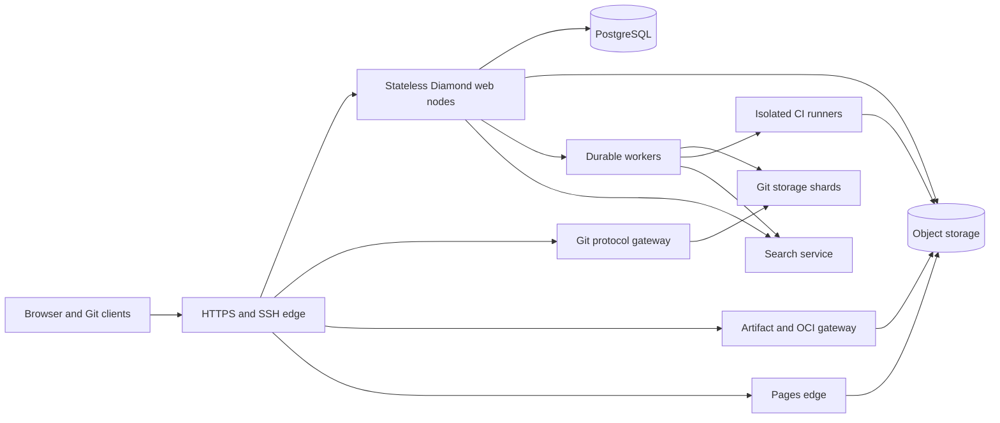

# Feature: Diamond Git Web Platform

## Summary

Build a complete, self-hostable Git collaboration platform whose application logic and reactive interface are written in Diamond while the installed Git executable remains authoritative for repositories. The platform supports public and restricted deployments, secure Google and GitHub sign-in, repositories and collaboration, native CI/CD, generic build artifacts, OCI images, and static Pages while keeping application memory bounded through streaming and isolated services.

This design extends Diamond 0.16.0. It does not weaken Diamond with a general shell, process, filesystem, or socket primitive. New native services expose narrow, versioned protocols and receive only short-lived, operation-specific authority.

## Requirements

- REQ-1: Keep product rules, policies, server-rendered pages, and reactive components in Diamond. Use the installed Git executable for repository semantics through a fixed native service API; never expose arbitrary command execution, paths, environment variables, Git configuration, hooks, SQL, or sockets to Diamond programs.
- REQ-2: Support administrator-configured account enrollment policies for public signup, verified email-domain membership, Google Workspace tenant membership, GitHub organization membership, an explicit identity allowlist, expiring invite codes, and closed enrollment. Policies may combine conditions, deny by default when required evidence is unavailable, and produce an auditable decision.
- REQ-3: Support Google OpenID Connect and GitHub OAuth web login. Use Authorization Code with PKCE S256, one-use transaction-bound state, nonce where the provider supports it, exact HTTPS callback URLs, issuer and audience validation, provider-specific stable subject identifiers, and safe key rotation. Do not join accounts by email alone and do not retain provider access or refresh tokens unless a configured membership check requires them.
- REQ-4: Provide secure web sessions and Git credentials: rotating server-side sessions, CSRF protection, global logout, account disablement, SSH keys, deploy keys, short-lived clone credentials, and hashed, expiring, scope-limited personal and project access tokens. Account linking and credential changes require a current session plus provider reauthentication or another administrator-approved recovery ceremony.
- REQ-5: Provide users, organizations, teams, projects, nested groups, public/internal/private visibility, ownership transfer, archiving, deletion retention, forks, stars, watches, and role-based permissions. Apply authorization before lookup, search, counts, feeds, Git negotiation, artifacts, the OCI registry, Pages, and background work so hidden-object existence is not disclosed.
- REQ-6: Create, import, mirror, fork, rename, transfer, archive, restore, and delete repositories. Store each bare repository on exactly one fenced writable Git storage shard at a time, identify it by an opaque repository ID, and replicate or back it up without mounting one writable repository on multiple shards.
- REQ-7: Support Git smart protocol v2 over HTTPS and SSH for clone, fetch, push, shallow clone, partial clone, tags, branches, atomic pushes, push options, and standard credential helpers. Stream protocol bytes with backpressure and preserve Git client error behavior without buffering complete packs in Diamond or PostgreSQL.
- REQ-8: Provide bounded web views for repository trees, blobs, raw files, rendered Markdown, commit history, commit details, diffs, blame, contributors, branches, tags, compare, archives, submodules, commit signatures, and permanent links. Binary, generated, oversized, or unrenderable content must degrade to metadata and a controlled download.
- REQ-9: Provide issues, threaded comments, mentions, reactions, labels, milestones, iterations, assignees, saved filters, task lists, issue templates, boards, wikis backed by Git, snippets, discussions, and cross-references. Markdown and uploaded content are sanitized and external references never grant authority.
- REQ-10: Provide merge requests with source and target branches across forks, merge-base-aware diffs, inline and general comments, review threads, requested reviewers, approvals, Code Owners, draft state, conflict status, mergeability, squash/rebase/merge strategies, merge queues, auto-merge, status checks, and stale-approval rules.
- REQ-11: Enforce protected branches and tags, allowed push/merge roles, force-push and deletion rules, required approvals, required successful pipelines, required resolved discussions, signed-commit policies, secret-push protection, and environment deployment approvals in the authoritative receive and merge paths.
- REQ-12: Provide project, organization, and global search across accessible repositories, code, commits, issues, merge requests, users, releases, artifacts, and wikis; notifications through the web and email; activity feeds; saved subscriptions; and read/unread state. Search indexes and feed projections are rebuildable and may never expand access beyond the authoritative policy check.
- REQ-13: Provide Git LFS, release assets, source archives, release notes, checksums, retention policies, resumable uploads, quotas, and content-addressed deduplication. Large objects live in the shared object store and use authenticated streaming or narrowly scoped signed URLs.
- REQ-14: Provide versioned REST and GraphQL-style APIs, service accounts, OAuth application registration for third-party clients, webhooks with signed deliveries, commit statuses, checks, integrations, and import/export. Every token, application, webhook, and callback has explicit scopes, destination policy, expiry or revocation, rate limits, and audit events.
- REQ-15: Execute native CI/CD pipelines defined in a versioned repository configuration. Support stages, dependency graphs, matrices, services, artifacts, caches, variables, protected secrets, environments, deployments, schedules, manual gates, retries, cancellation, concurrency groups, child pipelines, logs, test reports, coverage, and status reporting.
- REQ-16: Run CI jobs on separately registered runners with one-job isolation, immutable job identity, short-lived credentials, declared CPU/memory/time/storage/network limits, protected-runner rules, log redaction, cancellation fencing, and no implicit access to the control plane, host, sibling jobs, or unrelated project data. Shared runners must use disposable virtual machines or equivalently isolated sandboxes; containers alone are not the security boundary for untrusted public jobs.
- REQ-17: Host generic versioned build artifacts through Diamond's authenticated web and API interfaces. Support immutable publication, provenance and checksum metadata, scoped publish/read/delete credentials, retention, dependency links, and artifact-to-source and artifact-to-pipeline relationships without implementing language-specific package registries.
- REQ-18: Host an OCI Distribution 1.1 compatible container and artifact registry with push, pull, tags, manifests, indexes, cross-repository blob mounting under authorization, resumable uploads, deletion and retention, referrers, signatures/attestations, garbage collection, and repository-scoped bearer tokens.
- REQ-19: Publish static Pages from an explicitly selected CI artifact. Support project and organization sites, preview deployments, custom domains, automatic TLS, access-controlled sites, redirects, deployment history, rollback, cache invalidation, and quotas. Pages content runs on a separate origin and receives no Diamond session cookies or control-plane credentials.
- REQ-20: Enforce documented memory, process, output, time, and concurrency budgets. Ordinary control-plane requests must remain bounded; Git packs, LFS objects, OCI blobs, CI artifacts/logs, archives, and Pages assets must stream through fixed-size buffers. No operation may load a repository, pack, artifact, log, or unbounded result set into memory.
- REQ-21: Define authoritative state and recovery for every cross-service operation. Git objects and refs are authoritative on the owning shard; PostgreSQL is authoritative for identity, authorization, collaboration, and service metadata; object storage is authoritative for named immutable blobs. Use idempotency keys, fencing, durable outboxes, reconciliation, and explicit unknown outcomes rather than assuming a distributed rollback.
- REQ-22: Defend the public surface against request smuggling, traversal and revision confusion, command/config injection, malicious Git objects, decompression bombs, XSS, CSRF, SSRF, open redirects, OAuth mix-up and account-linking attacks, webhook loops, credential disclosure, abusive Markdown, fork-based permission confusion, storage exhaustion, and denial-of-service. Rate limits and quotas are shared across application nodes.
- REQ-23: Support multiple stateless Diamond web nodes, PostgreSQL high availability, multiple fenced Git storage shards, horizontally scalable workers, external object storage, independent runners, and separate registry, search, and Pages processes. Provide online draining, version compatibility checks, encrypted backups, point-in-time PostgreSQL recovery, repository and object restoration, and documented disaster recovery.
- REQ-24: Provide administrator controls for enrollment, identity providers, quotas, retention, storage placement, runner registration, feature policy, abuse response, legal holds, export, and deletion. Emit structured redacted logs, metrics, traces, immutable audit events, health/readiness, queue depth, storage integrity, runner state, and recovery status without exposing secrets or repository contents.
- REQ-25: Provide a responsive, keyboard-accessible, screen-reader-usable Diamond interface with server rendering, hydration, progressive forms, optimistic updates only where outcomes are reversible, live notifications, syntax highlighting, theme support, mobile layouts, and stable canonical URLs. Essential repository and account workflows remain usable without client JavaScript.
- REQ-26: Qualify the release through real browsers, Git clients, SSH, HTTP APIs, PostgreSQL, storage shards, object storage, artifact transfers, OCI clients, CI runners, DNS/TLS, backup/restore, and failure injection. Retain replayable evidence, exact versions and hashes, a coverage ledger, adversarial findings, fixes, and acknowledged residual trust boundaries.

## Acceptance Criteria

- [ ] AC-1 (REQ-1): A Diamond application implements the product UI and policy while a hostile test program cannot execute an undeclared binary, choose a repository path, add Git configuration, install a hook, open a socket, or bypass the versioned Git service contract. The same repository passes native `git fsck` before and after supported operations.
- [ ] AC-2 (REQ-2): In real login flows, public enrollment admits any provider-verified identity; each restricted mode separately admits and denies matching/nonmatching Google tenants, verified domains, GitHub organizations, named identities, valid/expired/replayed invite codes, and closed enrollment. Provider or membership API failure denies restricted creation and records a reason without identity secrets.
- [ ] AC-3 (REQ-3): Google and GitHub login pass normal, cancellation, replay, wrong-state, wrong-nonce, wrong-issuer, wrong-audience, expired-token, key-rotation, callback-confusion, PKCE-downgrade, mix-up, unverified-email, and duplicate-subject tests. Two provider accounts sharing an email remain separate until an authenticated link operation succeeds.
- [ ] AC-4 (REQ-4): Alternating requests across two web nodes preserves a valid session. Login rotates the session; logout, disablement, global logout, key revocation, and token revocation deny new requests on both nodes after commit. SSH keys, deploy keys, short-lived credentials, and scoped tokens succeed only for their declared repository, operation, and lifetime, and only token digests are stored.
- [ ] AC-5 (REQ-5): A permission matrix exercises owner, administrator, maintainer, developer, reporter, guest, external collaborator, anonymous user, nested team, fork, and public/internal/private project across UI, API, Git, search, artifacts, registries, Pages, jobs, and notifications. Unauthorized requests cannot distinguish missing objects from hidden ones where policy requires concealment.
- [ ] AC-6 (REQ-6): Create, import, mirror, fork, rename, transfer, archive, restore, soft-delete, expire, and restore repositories through public interfaces. Force a storage-owner failover and prove fencing prevents the old shard from accepting writes while clones, refs, hooks, metadata, and backups remain consistent on the new owner.
- [ ] AC-7 (REQ-7): Stock supported Git clients clone, fetch, and push over HTTPS and SSH using protocol v2, including shallow and filtered clones, tags, atomic multi-ref pushes, push options, an interrupted transfer, a slow client, and a rejected protected-ref update. Independent process and memory observations show bounded buffers and released children after cancellation.
- [ ] AC-8 (REQ-8): Against repositories containing large trees, long history, binary files, Unicode paths, unusual valid ref names, submodules, signed commits, and oversized diffs, every browser view either renders within its documented limit or returns a stable truncation/download response. Pagination has deterministic cursors and no page decodes an unbounded Git result.
- [ ] AC-9 (REQ-9): Real browser sessions create and edit issues, comments, reactions, labels, milestones, iterations, tasks, boards, wiki revisions, snippets, discussions, mentions, and cross-references. A stored-XSS and malicious-link corpus is inert under the rendered Content Security Policy, and authorization remains correct after transfers, forks, and membership revocation.
- [ ] AC-10 (REQ-10): Merge requests cover same-repository and fork branches, changed merge bases, renames, binary files, inline threads, Code Owners, stale approvals, conflicts, all merge strategies, merge queues, auto-merge, and a source update during merge. The committed result matches the reviewed head and target or the operation aborts without merging.
- [ ] AC-11 (REQ-11): Direct Git pushes, web edits, API updates, merges, bots, deploy keys, and administrators all traverse the same protected-ref rules. Attempts to bypass required checks, approvals, signatures, secret detection, force-push limits, tag protection, or environment gates fail before authoritative refs or deployments change.
- [ ] AC-12 (REQ-12): Search and feeds return only accessible records before and after membership revocation, visibility changes, transfers, indexing lag, index rebuild, and cache loss. Notifications deduplicate events, preserve per-user read state, honor subscriptions, and never include hidden content in subject lines, snippets, or URLs.
- [ ] AC-13 (REQ-13): Stock Git LFS clients upload and download resumably, verify SHA-256 object identity, enforce quotas, reject size/hash mismatches, and survive interrupted finalization. Releases and archives stream with correct disposition and range behavior; retention and garbage collection preserve referenced data and remove eligible unreferenced objects after the safety window.
- [ ] AC-14 (REQ-14): REST, GraphQL-style queries, OAuth applications, service accounts, webhooks, imports, exports, statuses, and checks pass scope, pagination, complexity, expiry, revocation, destination, signature, replay, retry, and rate-limit tests. Webhook DNS rebinding, redirects to forbidden networks, and cross-origin callback substitution are denied.
- [ ] AC-15 (REQ-15): Repository pushes trigger pipelines that exercise dependency graphs, matrices, services, caches, artifacts, masked/protected variables, environments, schedules, manual approvals, retries, cancellation, concurrency groups, child pipelines, live logs, test reports, and coverage. Duplicate delivery does not duplicate a logically unique pipeline, and stale jobs cannot report success after cancellation.
- [ ] AC-16 (REQ-16): Adversarial jobs attempt host escape, control-plane access, sibling access, metadata-service access, credential reuse, fork secret access, resource exhaustion, log exfiltration, and post-cancellation writes. Isolation and policy deny them; runner destruction removes job disks and credentials; a compromised runner can affect only the currently granted job resources documented in the threat model.
- [ ] AC-17 (REQ-17): Browser and raw HTTP clients publish, discover, download, authenticate, reject unauthorized overwrite/delete, and verify checksums for generic project artifacts. Large artifacts stream, concurrent same-version publication has one winner, and retention preserves referenced or legally held versions. The runtime test environment requires no Ruby, Python, Node.js, Java, .NET, PHP, or other package-ecosystem runtime.
- [ ] AC-18 (REQ-18): The OCI Distribution conformance suite plus Docker, Podman, and an OCI artifact client exercise authentication, push, pull, mount, resume, tags, indexes, referrers, signatures, attestations, deletion, and garbage collection. Invalid digests, foreign namespaces, manifest/blob mismatches, and authorization forwarding across redirects are rejected.
- [ ] AC-19 (REQ-19): A CI artifact publishes to project, organization, preview, private, and custom-domain Pages targets; automatic TLS renews; rollback restores the prior immutable deployment; cache invalidation is observable. A hostile page cannot read control-plane cookies, call privileged browser APIs with ambient credentials, or claim another project's hostname.
- [ ] AC-20 (REQ-20): On the qualified Linux profile, an idle web node and idle Git storage service each remain below their documented resident-memory target, and the complete control plane excluding PostgreSQL, object storage, search, and runners operates within a 1 GiB host profile. Concurrent large Git, LFS, artifact, OCI registry, archive, and log transfers remain within configured aggregate budgets or receive backpressure/overload responses without process death.
- [ ] AC-21 (REQ-21): Inject failure before and after every durable boundary in create, push, merge, artifact publication, release publication, Pages deployment, and deletion. Reconciliation converges confirmed state, preserves explicit unknown outcomes, prevents stale writers through fencing, and never replays a non-idempotent external effect without a stable idempotency key.
- [ ] AC-22 (REQ-22): A retained adversarial campaign covers the named attack classes with malformed protocols, hostile repositories, race conditions, storage pressure, and distributed rate-limit races. Reproduced real findings receive root-cause fixes and regression replays; the report distinguishes tested paths, untested paths, and trusted dependencies.
- [ ] AC-23 (REQ-23): Run two web nodes, two workers, two Git shards, multiple runners, shared PostgreSQL, and object storage without sticky sessions. Drain and roll versions, lose each non-database service in turn, fail over a repository, restore PostgreSQL to a point in time, restore repositories and blobs into isolation, and prove recovery-point and recovery-time objectives from independent state checks.
- [ ] AC-24 (REQ-24): Administrators configure every listed policy through authenticated interfaces; privileged changes require recent reauthentication and generate immutable audit events. Metrics and logs demonstrate useful diagnosis while canary credentials, OAuth tokens, repository contents, CI variables, and artifact contents remain absent from responses, diagnostics, logs, traces, and browser artifacts.
- [ ] AC-25 (REQ-25): Keyboard-only and screen-reader runs complete signup, login, repository creation, browsing, issue creation, review, merge, pipeline inspection, artifact discovery, and settings. The same essential flows work with JavaScript disabled; hydration, stale responses, failed navigation, reconnect, and browser history preserve the last confirmed state and display bounded errors.
- [ ] AC-26 (REQ-26): Release evidence records exact source and binary hashes, Git and protocol client versions, environment, test seeds, browser actions, independent database/storage observations, failures before fixes, final replays, resource measurements, and a feature-to-interface coverage ledger. No green suite or inventory is presented as proof of unexercised behavior.

## Architecture

### Current Diamond foundation and required extension

Diamond already supplies most control-plane primitives. `src/project/mod.rs` defines checked project manifests and separates server, browser, and shared modules. `src/project/connected.rs` provides bounded concurrent serving, request semaphores, trusted-origin validation, shared PostgreSQL state, and draining. `src/project/accounts/` provides open, invite, and closed enrollment, server-side sessions, revocation, scoped credentials, rate limits, and account administration. `src/project/api.rs`, `src/project/jobs.rs`, `src/project/events.rs`, and `src/project/files/` provide explicit APIs, durable work, live events, and streamed private objects. `src/integrations.rs` confines secrets and outbound HTTP, while `src/host.rs` demonstrates a small typed native-operation contract.

The missing primitive is intentionally absent: Diamond cannot run Git or inspect arbitrary repository paths. The implementation adds a `git` manifest section and repository-parameterized checked effects named `GitRead`, `GitWrite`, and `GitAdmin`. These effects call a new versioned Rust client in the runtime. The client talks to a dedicated `diamond-git-service`; it does not provide a general process adapter. The product itself will live as a multi-file application under `examples/forge/` until it becomes a separately packaged reference application.

The same pattern applies to generic build artifacts, OCI artifacts, Pages, search, and runners. Diamond code owns authorization and workflow decisions. Native services own protocol parsing, byte streaming, process isolation, and formats that cannot safely or efficiently cross the managed-value boundary.

### System layout

The edge routes browser and API traffic to Diamond web nodes, Git HTTPS/SSH to the Git gateway, generic artifact and OCI traffic to their gateway, and published sites to the Pages edge. All services use distinct listeners and identities. Internal calls use mutually authenticated TLS across hosts or Unix sockets on the same host. Network policy permits only named service relationships.

Every data-plane request carries a signed, audience-bound claim lasting at most five minutes. A claim names the principal epoch, repository or namespace ID, exact operation, permitted refs or object class, request ID, expiry, and authorization generation. Services reject wrong audiences, replay where the operation is single-use, stale account epochs, expired claims, and claims issued before a relevant authorization or protection-rule change. Long transfers may refresh authority through a control channel but cannot broaden it.

### Identity and enrollment

The existing `Enrollment` enum in `src/project/accounts/mod.rs` becomes a checked enrollment policy rather than one of three fixed modes. A policy is an ordered set of explicit allow conditions with an optional public fallback:

- any Google or GitHub identity with provider-verified stable subject;
- verified email address in an exact administrator-owned domain list;
- Google `hd` tenant claim in an exact list;
- active GitHub organization membership obtained with the configured provider scope;
- exact provider plus subject or normalized verified-email allowlist entry;
- valid one-use or bounded-use invite code with expiry and optional organization/team assignment;
- pre-provisioned account only;
- closed enrollment.

Rules state whether any or all conditions must match. Deny rules take precedence. Email-domain rules use verified addresses but are documented as weaker than Google tenant or GitHub organization evidence. Google company restrictions validate the signed `hd` claim; sending `hd` in the authorization request is only a user-interface hint. GitHub organization restrictions query the documented membership API and fail closed when the membership cannot be established.

External identities use the unique key `(provider, issuer, subject)`. Google uses the ID token `sub`; GitHub uses the stable numeric user ID from the authenticated user API, never the mutable login or email. A newly admitted identity creates one local user inside the account and rate limits. Username collisions enter a bounded selection flow. Email equality never links accounts. Linking requires an authenticated local session, recent reauthentication to the already linked provider, completion of the new provider flow, and an audit event. Unlinking may not remove the final usable login method without an administrator recovery method.

OAuth transactions are server-side PostgreSQL records containing digests of state and nonce, an envelope-encrypted PKCE verifier, provider, intended post-login path ID, browser-session binding, creation time, and one-use status. They expire after ten minutes, and the verifier is deleted during the single callback attempt. Callback paths are fixed per provider, accept no user-selected redirect target, and use an allowlisted internal destination ID after success. Client secrets are secret handles and never appear in Diamond source, build output, JavaScript, logs, or PostgreSQL rows intended for application access.

Google uses OpenID Connect discovery and validates signature, algorithm allowlist, issuer, audience, authorized party when present, expiry, issued-at skew, nonce, email verification, and tenant policy. GitHub uses its OAuth web flow with PKCE S256 and state, exchanges the code server-side, calls only fixed GitHub API endpoints, validates the returned stable user ID and verified emails needed by policy, and discards the access token after admission checks unless continuing organization membership enforcement is enabled. Retained provider tokens are envelope-encrypted, excluded from application queries, and revoked or deleted on unlink.

Web sessions extend the current records in `src/project/accounts/sessions.rs`: 128-bit-or-stronger random opaque tokens, digest-only storage, Secure and HttpOnly cookies, SameSite=Lax, fixed public origin, rotation at privilege change, idle and absolute expiry, account epoch validation, and CSRF on mutations. OAuth callback state protects the callback; normal session CSRF resumes immediately afterward. A command-line recovery ceremony can create a short-lived, single-use administrator recovery link from the deployment host without enabling public password login.

Git-over-HTTPS accepts a personal, project, deploy, or short-lived credential through HTTP Basic or bearer authentication as the relevant client supports. SSH maps a public-key fingerprint to an account, deploy key, or certificate principal. The SSH service accepts only Git's upload-pack, receive-pack, or archive command grammar and resolves the repository name through PostgreSQL; it never passes a client path or shell fragment to a shell.

### Repository service and Git execution

PostgreSQL stores repository identity, canonical namespace/name, visibility, owning shard, storage generation, object-format metadata, default branch, quotas, and lifecycle state. A Git shard stores bare repositories below a root controlled by the service account, using opaque repository IDs rather than user-controlled names. Repository paths are constructed from validated IDs and verified beneath the root through descriptor-relative operations. Symlinks, alternate object databases outside approved shard roots, replacement refs, repository-supplied configuration includes, and arbitrary hook paths are forbidden.

The Git service starts processes with fixed executable paths and an allowlisted argument vector. It never invokes a shell. It clears the environment and sets a private home, fixed locale, disabled prompts, controlled system/global configuration, protocol allowlists, safe-directory policy, and fixed hook directory. User-provided revisions are separated with `--end-of-options`, validated according to the operation, and resolved to object IDs before later calls. User paths use literal pathspec handling and NUL-delimited formats. Repository content can never supply an executable server hook.

Smart HTTP and SSH stream to `git-upload-pack`, `git-receive-pack`, and approved archive plumbing. Protocol v2 is preferred. Fetch permits reachable-object negotiation according to visibility and configured partial-clone filters. Push enters Git's quarantine area. A trusted pre-receive controller receives proposed ref old/new IDs over a structured pipe, verifies the signed claim, reloads current membership and protection generation, checks object counts and sizes, rejects forbidden object types or hidden-object reachability, runs bounded secret and policy checks, and either accepts all requested ref updates or rejects them. Post-receive writes a durable local event spool before acknowledging completion; an idempotent worker projects ref changes, activities, indexing, pipelines, mirrors, and notifications into PostgreSQL. Reconciliation compares Git refs with projected generations after any uncertain outcome.

Git remains authoritative for objects and refs. PostgreSQL ref tables are caches for display and scheduling. A merge operation records the reviewed source object, target object, strategy, approvals, and rule generation; creates and validates the result on the owning shard; then performs a compare-and-swap ref transaction. If either head moved, it aborts. The audit row and post-receive projection identify the exact committed object.

Each repository has one writable owner lease and monotonically increasing storage generation. Lease acquisition requires fencing the prior owner through the placement controller. All mutating service claims include the generation. Replicas and backups are read-only. Failover promotes a verified replica or restored copy only after the old writer is fenced; split-brain availability is sacrificed to preserve refs.

### Bounded repository browsing

Browser reads use long-lived, per-repository `git cat-file --batch-command` helpers and short, fixed plumbing commands such as `for-each-ref`, `rev-list`, `diff-tree`, and incremental blame. Helpers are owned by the Git service, limited in count and lifetime, restarted after malformed output or resource limits, and never shared across repository authorization domains.

Default limits are configurable downward and have absolute release ceilings:

| Operation | Default bound | Release ceiling |
| --- | ---: | ---: |
| Tree page | 200 entries | 1,000 entries |
| Commit page | 50 commits | 200 commits |
| Rendered text/blob preview | 512 KiB | 1 MiB |
| Rendered Markdown input | 256 KiB | 1 MiB |
| Single-file diff | 5,000 lines or 1 MiB | 20,000 lines or 4 MiB |
| Whole change diff | 10,000 lines or 4 MiB | 50,000 lines or 16 MiB |
| Blame | 5,000 lines | 20,000 lines |
| Archive setup metadata | 4 MiB | 16 MiB |
| Git child wall time for a page | 10 seconds | 30 seconds |

Responses include explicit truncation metadata and stable continuation inputs where Git semantics permit them. Raw blobs and archives use the data plane and fixed buffers. Syntax highlighting runs incrementally over bounded previews. Markdown rendering disables raw HTML by default, rewrites links and images through safe policies, sanitizes the result, and applies a restrictive Content Security Policy.

### Collaboration and product data

Diamond resource types model users, external identities, organizations, groups, teams, memberships, projects, repositories, branch rules, issues, comments, labels, milestones, iterations, boards, merge requests, reviews, threads, approvals, environments, deployments, releases, webhooks, notifications, credentials, audit events, and retention holds. All tenant-bearing resources have explicit scope IDs so the authorization rules compile to the authorized-relation behavior already implemented by `src/policy/postgres.rs` and `src/relational/restriction.rs`.

The UI uses server-rendered routes for first paint and Diamond components for filtering, review navigation, comments, live pipeline state, notifications, and settings. Existing generation-scoped asynchronous behavior in `src/project/runtime.js` prevents stale requests from overwriting newer route or review state. Operations with uncertain outcomes display pending reconciliation rather than optimistic success.

Wikis use a separate bare Git repository linked to the project and traverse the same storage service. Snippets use small Git repositories with stricter quotas. Forks share objects only through Git-supported, administrator-controlled storage optimization; authorization never depends on object sharing. Removing a fork relationship does not expose the parent or retain implicit permission.

### Search, notifications, and events

PostgreSQL full-text and trigram indexes cover bounded collaboration metadata. A separate search service indexes repository content from immutable commit/object IDs. Index jobs carry repository visibility and authorization-generation metadata, but query results are candidates only: the Diamond policy layer reauthorizes each repository before returning hits. Deleted or newly private repositories enter a high-priority tombstone queue; until processed, authoritative filtering still hides them.

Global code indexing is optional per deployment and quota. A small installation can use bounded per-repository Git search without keeping a resident global index. The index service uses memory-mapped, sharded segments and explicit cache ceilings. Index loss affects search freshness, never repository integrity, and a full rebuild is supported.

The transactional outbox in `src/project/jobs.rs` fans authoritative events into notifications, email, indexing, webhooks, mirrors, pipeline creation, and activity projections. Consumers deduplicate by event ID. Email jobs render only content the recipient is still authorized to see and reduce hidden/deleted objects to a generic notice. Live delivery extends `src/project/events.rs`; reconnect uses cursors and resynchronizes after retention gaps.

### Git LFS, releases, generic artifacts, and OCI registry

The object store holds immutable bytes addressed by SHA-256 plus tenant ownership/reference records in PostgreSQL. Uploads follow the staged, streamed, hash-verified pattern in `src/project/files/transport.rs`, expanded for multipart and range operations. Publication is a metadata transaction from a complete quarantined object to an authorized named reference. Deletion removes the reference; garbage collection removes bytes only after reference reconciliation, retention windows, replication checks, and legal holds.

Git LFS implements the documented batch API, basic transfer adapter, lock API, resumable transfer extensions where clients support them, and repository/ref authorization. Batch responses issue narrowly scoped, short-lived transfer URLs. LFS pointer parsing is bounded and verifies SHA-256 and declared size.

The generic artifact gateway uses Diamond's versioned HTTP API rather than emulating language-specific registries. Publication is immutable by default and binds project, artifact name, version, digest, source commit, pipeline, signer, and attestation in one idempotent record. Browsers, CI jobs, and ordinary HTTP clients can publish and retrieve artifacts with scoped credentials; no language-specific runtime or package manager is part of the server architecture.

The OCI service implements the OCI Distribution 1.1 API. Blobs are content-addressed in the shared object store; manifests and tags are authorized repository metadata. Bearer tokens use a separate registry audience and exact pull/push/delete scopes. Cross-repository mounts require read on the source and write on the target. Garbage collection traces all manifests, indexes, referrers, uploads, retention rules, and holds before deleting a blob.

### CI/CD and runner isolation

Pipeline configuration is read from an immutable commit after the push is accepted. A versioned parser converts it to a bounded job graph: node count, matrix expansion, dependency depth, variable sizes, artifact declarations, services, and includes all have configured ceilings. Remote includes are off by default and, when enabled, resolve to pinned commits or destination-scoped HTTPS content with retained digests. Repository configuration cannot create a new host capability.

The scheduler stores pipeline and job state in PostgreSQL and uses leases plus fencing. A runner registers an administrator-approved key and capabilities. For each job it receives a single-use job identity, repository fetch credential, scoped object-store URLs, declared secrets, network profile, and deadline. These expire at job completion or cancellation. Protected secrets and deployment credentials are withheld from untrusted forks and unprotected refs.

Public shared runners execute each job in a disposable micro-VM or equivalent hardware-virtualized sandbox created from an immutable image. Private deployments may explicitly approve other executor profiles for trusted projects. The runner applies CPU, resident memory, process, disk, I/O, wall-time, and egress limits; blocks the host and cloud metadata endpoints; mounts no control-plane sockets; and destroys the job environment after uploading declared outputs. Runner logs stream in bounded chunks through a redaction pipeline, but redaction is defense in depth and secret scope remains the primary control.

Artifacts, caches, reports, and logs live in object storage. Artifacts are immutable and policy-bound. Cache keys are project and trust-domain scoped; untrusted forks cannot poison protected caches. Deployment jobs write environment state through a short-lived deployment claim and may require a human approval recorded after the exact job and artifact digest are known.

### Pages

Pages deployment consumes an immutable CI artifact after path, file-count, expanded-size, symlink, MIME, and archive-bomb checks. It creates an immutable deployment manifest in object storage and atomically changes the site's active deployment pointer. Rollback changes that pointer to a retained manifest.

The Pages edge is a separate service and registrable domain from the control plane. It never receives Diamond session cookies, OAuth callbacks, access tokens, or control-plane Content Security Policy exceptions. Public sites are static and aggressively cacheable. Private sites use a Pages-specific audience token obtained through a top-level control-plane authorization redirect, then stored in a host-only cookie for that Pages domain. Custom-domain ownership uses DNS challenges; certificates renew automatically; hostname uniqueness and certificate issuance are transactional and audited.

### API, webhooks, and third-party OAuth applications

The current fixed-operation API in `src/project/api.rs` grows a versioned resource API with cursor pagination, field and query complexity budgets, and typed errors. A GraphQL-style endpoint is a checked query planner over the same authorized relations; it is not arbitrary resolver execution. Introspection can be disabled for anonymous clients, and every request has depth, node, cost, time, and response-byte limits.

Third-party OAuth applications are distinct from Google/GitHub login providers. They use registered exact HTTPS redirects, Authorization Code with PKCE, explicit user consent, narrow platform scopes, revocable grants, short access-token lifetimes, rotating refresh tokens, and application ownership/audit controls. Implicit and resource-owner-password grants are unsupported.

Webhooks use `src/integrations.rs` destination enforcement with stricter public-IP resolution, connection pinning, redirect revalidation, port policy, TLS, request deadlines, body limits, and per-destination concurrency. Each delivery includes an event ID, timestamp, and HMAC signature. Retries are at least once with the same event ID. Receivers are expected to deduplicate. Responses are bounded and discarded except for diagnostic metadata.

### Memory and resource profile

The platform is memory-light by construction, with separate budgets for the control plane and workload plane. The release target for the qualified Linux build is:

- an idle Diamond web node at or below 128 MiB resident memory;
- an idle Git gateway/storage daemon at or below 128 MiB resident memory before Git children;
- a small single-host control plane containing edge, one web node, one worker, and one Git service within 1 GiB, excluding PostgreSQL, object storage, global code search, and CI job memory;
- fixed 64 KiB default and 256 KiB maximum buffers per direction for Git, LFS, artifact, OCI registry, archive, and log streams;
- a 2 MiB decoded body ceiling for ordinary APIs and forms, with narrower endpoint defaults;
- one Git browsing child per active repository by default, a bounded global child semaphore, and idle helper eviction;
- one pack thread by default, configured Git `pack.windowMemory`, delta cache, pack size, and child address-space ceilings selected from the deployment budget;
- explicit overload responses when semaphores, pools, queues, or memory reservations are unavailable.

CI runner memory is never charged to the web node and is controlled by the job profile. Search has a separate administrator-selected budget and can be disabled. PostgreSQL pools remain bounded as in `src/relational/pool.rs`. Large payloads are never represented as Diamond `Text` or `List` values; the compiler rejects adapters that declare a streamed type as an ordinary wire value.

### Consistency, deletion, backup, and recovery

Cross-service workflows are state machines with stable operation IDs. A repository creation reserves metadata, assigns a generation, creates and fsyncs the bare repository, and then marks it active. Cleanup can safely remove an abandoned reservation. Push is authoritative when Git commits refs even if the client loses the acknowledgment; reconciliation reports the actual ref state. Artifact and Pages publication is authoritative when the named metadata reference commits; uploaded bytes without references remain quarantined and collectible.

Deletion is soft by default. A tombstone immediately removes access and blocks new writes, while retention preserves recoverability. Final deletion is a durable job that rechecks legal holds, forks, mirrors, LFS, artifacts, OCI registry references, Pages deployments, and backups before removing references. Physical bytes follow delayed garbage collection. Administrators receive a dry-run manifest before bulk deletion.

`src/project/deployment/backup.rs` expands from application snapshots to a coordinated backup catalog. PostgreSQL uses continuous archiving and point-in-time recovery. Git shards create crash-consistent snapshots or bundles plus ref manifests and run `git fsck` on sampled and restored repositories. Object storage uses versioning or immutable backup copies plus inventory/digest verification. CI runner disks and rebuildable search indexes are excluded. Restore always happens in an isolated namespace first, verifies identity counts, refs, objects, blobs, permissions, and audit continuity, then uses a fenced cutover.

### Security baseline and standards

Authentication follows [RFC 9700, OAuth 2.0 Security Best Current Practice](https://www.rfc-editor.org/rfc/rfc9700), [OpenID Connect Core 1.0](https://openid.net/specs/openid-connect-core-1_0.html), [Google's OpenID Connect server guidance](https://developers.google.com/identity/openid-connect/openid-connect), and [GitHub's OAuth web application flow](https://docs.github.com/en/apps/oauth-apps/building-oauth-apps/authorizing-oauth-apps). The provider adapters implement the intersection of the current standards and stricter provider requirements.

Git transport follows the installed Git version's [protocol v2](https://git-scm.com/docs/protocol-v2) and server plumbing. LFS follows the [Git LFS batch API](https://github.com/git-lfs/git-lfs/blob/main/docs/api/batch.md). The container registry follows the [OCI Distribution Specification](https://github.com/opencontainers/distribution-spec/blob/main/spec.md) and its published conformance suite. Exact supported versions are pinned in release evidence and updated only with compatibility and adversarial replay.

Security-sensitive parsers and protocol adapters use memory-safe Rust, strict schemas, duplicate-field rejection, bounded collections, timeouts, and fuzz corpora. Dependencies that interpret Git, SSH, archives, Markdown, artifact metadata, OCI manifests, JWTs, TLS, or CI configuration receive focused dependency review and rapid update procedures. Signed commits and artifacts display verified identity separately from account authorization; a valid signature does not grant repository permission.

### Delivery checkpoints

The implementation follows broad working strokes first and reserves fine-grained completion for the end.

1. **G1 — Walking repository slice.** Add the Git service contract, one storage shard, Google and GitHub login, configurable enrollment, repository creation, HTTPS/SSH clone and push, bounded tree/blob/history views, one issue flow, one merge-request flow, and a basic Diamond interface. Run the first browser and stock-Git demonstrations immediately.
2. **G2 — Collaboration breadth (complete).** Organizations, teams, forks, repository permissions, protected refs, full issues, boards, wikis, snippets, review threads, revocable approvals, fast-forward/squash/merge-commit strategies, notifications, releases, LFS, versioned REST operations, bounded webhooks, and audit events are implemented in the runnable Diamond application. Retained qualification exercises each trust boundary before visual refinement.
3. **G3 — Delivery and artifact breadth (complete).** The runnable application schedules immutable-commit pipelines from strict repository configuration, executes fenced jobs through an explicitly granted Bubblewrap or chroot-style systemd sandbox, restores reference-scoped caches, publishes environments and content-addressed generic artifacts, exposes repository-authorized streamed artifact and OCI pull routes, and atomically deploys static output to a separate cookie-free Pages listener. Retained qualification proves push through pipeline, artifact, OCI image, release, and Pages, plus cancellation, event deduplication, cache restoration, dependency failure, traversal, symlink, authorization, filesystem, network, and cleanup boundaries.
4. **G4 — Scale and recovery (complete).** The `operations-v1` layer provides shared web/worker heartbeats, compare-and-swap drain and policy controls, leased concurrent tasks, policy-reauthorized global search, exact-object stock-Git mirrors, repository-scoped promotion fencing, authoritative per-repository data-plane routing, held/grace-bounded delivery-object GC, shared search limits, recovery catalogs, redacted audit/metrics, and a separate Diamond operations console. The encrypted snapshot streams PostgreSQL plus every shared-object, Git, delivery, and operations root; isolated restore verifies the complete manifest before import, revokes credentials, repairs root-relative Git policy configuration, and revalidates the restored adapters.
5. **G5 — Product completion.** Fill protocol edge cases, accessibility, mobile layout, import/export compatibility, search quality, notification preferences, artifact workflows, runner executor profiles, custom-domain operations, and administrator documentation.
6. **G6 — Adversarial qualification.** Attack every trust boundary and distributed transition through real interfaces, repair reproduced issues, replay the full regression corpus, measure memory under concurrent streaming load, restore from backup, and publish the bounded release evidence.

G1 through G4 are implemented as `examples/git-browser`. The retained application
replay exercises the Diamond browser/server surface, PostgreSQL policy, team and
direct revocation, fork isolation, issue/board/knowledge flows, review-state
revocation, all three merge strategies, versioned REST authorization, bounded
webhook delivery, LFS integrity and ownership, stock smart HTTP Git, event
recovery, and strict repository fsck. The separate foundation and SSH campaigns
preserve the transport, OAuth, protected-ref, OpenSSH, deploy-key, certificate,
streaming, and shard-promotion coverage. The G3 delivery replay preserves the
CI, artifact, OCI pull, release, and Pages path. The G4 replay adds two web nodes,
concurrent leased workers, search revocation, exact mirrors, hostile replica roots,
repository-routed promotion, promoted-root reconciliation, GC holds, stale failover
generations, cross-node limits, coordinated drain, and full encrypted isolated
restore. G5 and G6 remain distinct product checkpoints.

Each checkpoint must leave a runnable vertical slice. Schema and service protocols are versioned early, but no compatibility machinery for unreleased external users is required while the project has no users. Later checkpoints may replace internal rough implementations as long as the checkpoint's public behavior and retained regression cases continue to pass.

## Open Questions

None. The requested product scope fixes the initial decisions: configurable public or restricted enrollment, Google and GitHub login, dedicated Git storage services, and native CI, generic artifacts, OCI registry, and Pages.

## Out of Scope

- Reimplementing Git object, pack, ref, merge, or wire semantics instead of using the installed Git executable.
- Building a new container runtime, hypervisor, PostgreSQL database, object store, SSH cryptographic implementation, ACME client, or TLS stack when a maintained implementation satisfies the service contract.
- Arbitrary repository-provided server hooks, control-plane plugins, shell access, SQL, filesystem access, or in-process native extensions.
- Dynamic server-side Pages applications. Pages hosts static CI output; interactive applications use the authenticated Diamond application platform.
- Language-specific package registries and dependencies on Ruby, Python, Node.js, Java, .NET, PHP, or their package managers. Generic artifacts and OCI images cover the requested Git-site workflows without those runtimes.
- SaaS billing, advertising, marketplace commerce, and jurisdiction-specific regulatory certification. Quotas, usage records, exports, retention, legal holds, and audit evidence needed to add those later remain in scope.
- Claiming resistance to every compromise. Release evidence states the tested profile and residual trust in Git, the operating system, PostgreSQL, object storage, the hypervisor or runner sandbox, TLS, Google, GitHub, and deployment administrators.
