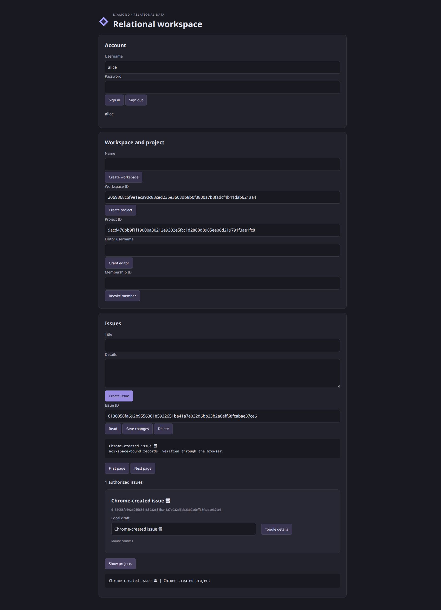

# W4 results — relational data and authorization

Completed 22 October 2026 as Diamond 0.10.0, within the local development profile.
The user explicitly removed old/new upgrade compatibility: W4 uses one current
schema, stopped-server migrations and resumable backfills. Mixed versions,
compatibility ranges, rollback windows and version leases were not implemented.
The full release's later features and production qualification remain outstanding.

## Delivered behavior

- Opt-in checked `relational-v1` storage: typed scalar/Option/unit-enum columns,
  nominal IDs, constrained lossless Unicode/NUL Text, primary/scoped unique keys,
  composite scoped foreign keys and declared indexes.
- SQL select/range/page/count/Int-sum and declared one-hop joins. Every query base
  has a read policy before its values can contribute to returned results. Stable
  `(sort,id)` cursors carry position and never cached authorization.
- Purpose-limited terminal ownership/membership lookups and workspace roles,
  without granting general read access to the membership directory.
- Serializable per-RPC pre/post/return-read authorization, row locks, sticky
  transaction failure, distinct confirmed concurrency abort versus unknown commit,
  no automatic mutation replay, bounded pool admission and confirmed cleanup.
- Explicit initialize/status/additive-migrate/bounded-backfill/audit CLI and public
  Rust methods, schema hashes/catalog fingerprints and separate runtime/migrator
  authority. Startup refuses an absent or incompatible current schema.
- A Diamond reference UI for workspaces, projects, editor grants/revocation,
  issue CRUD, pages, totals and joins. See [guide](../docs/relational-apps.md).

## Operated evidence

Executable SHA-256:
`15dfe6108d99a9defe3e5bd4304d0b9d720ed1203859e58e287d0b2ed4b06166`

Library SHA-256:
`f8e777be87138f2622c038c9799294de157c1ca7ad9fb57ec039e7a6958576e7`

| Interface/campaign | Observed result |
| --- | --- |
| Independent real checker | 30 schema/query/lookup boundary observations pass |
| Independent real PostgreSQL and generated RPC | 98 typed-value, CRUD, catalog, startup and corruption/recovery observations pass; constrained role; two servers |
| Independent 100,003-row model campaign | 175 observations and 473 actual HTTP requests pass across seven workspaces and mixed identities; 143 pages contain exactly 14,286 unique ordered IDs |
| Actual generated SQL plan | Captured PostgreSQL SELECT and bindings, then EXPLAIN ANALYZE: ordered Issues Index Scan returns 17 rows, no Sort; exact plan retained |
| Native and migration interfaces | 18 observations pass, including real public Rust consumer, coordinator contention, killed in-flight backfill, committed checkpoints, preserved existing values, and reads from two restarted current-schema nodes |
| Real failure schedules | 14 observations pass: earlier-snapshot revocation, later denial on both nodes, HTTP delivery loss, lost actual PostgreSQL COMMIT acknowledgment, confirmed deferred 40001, 32 concurrent callers, at most eight runtime connections across two nodes, no idle transactions, database outage/restart and stale-connection replacement |
| Chrome controls | Nine grouped journeys pass: login, 10+2 disjoint pages, create/edit/read, literal hostile-looking text, totals/joins, sign-out cleanup, outsider denial, workspace/project creation, scoped FK denial/recovery, approved editor grant/write/revoke/denial |
| Actual database domains | 17 rollback-only writes check real generated Text constraints: NUL, maximum Unicode scalar, 120-astral/combining boundaries, overlong/surrogate/out-of-range/truncated UTF-8, uppercase/odd/nonhex, CR/LF tail and length rejection; committed data unchanged |
| Browser fixture independent audit | Valid; 15 issues, zero remaining memberships, two projects and two workspaces; final graceful shutdown exit zero and no cleanup errors |
| Affected existing current-source interfaces | Project/PostgreSQL and connected campaigns pass; existing independent frontend: 185 semantics, 30 checker, 121 wire, three saved regressions, five native checks and 184 native corpus values pass |
| Build quality | Build, strict Clippy without new allowances, format, warning-denied rustdoc and all 26 doctests pass on Rust/Cargo 1.96.0; zero unit tests in this repository; no unsafe changes, so Miri is not applicable |

The version moves from 0.9.0 to 0.10.0 (pre-1.0 minor); the public administrative
methods and `Error::Conflict` are new. MSRV remains 1.96. Builds declare wire
version 3 for the new typed abort code; rebuild trusted source applications.

The [independent coverage ledger](w4_independent/COVERAGE.md) maps the prewritten
oracles to actual caller paths and gaps. Its [final receipt](web_four_independent_results.json)
has SHA-256 `ca63cbb2db1216a3e8bd380e69944ae7315b3aed2335e540e48e4cf245864a56`.
The [final state](web_four_final_state.json) records source/app/receipt hashes,
build checks and cleanup. Separate receipts retain
[Chrome](web_four_browser_results.json), [database readback/audit](web_four_browser_database.json),
[lifecycle](web_four_browser_lifecycle.json), [physical domains](web_four_domains_results.json),
[existing projects](web_four_existing_projects.json),
[existing connected behavior](web_four_existing_connected.json) and
[existing frontend behavior](web_four_existing_frontend.json).

## Findings fixed and replayed

1. A native server record configured as a join output was missing from the module
   symbol map. Resolve checked source-level server records as well as shared
   symbols. The saved source fixture now checks successfully.
2. Initial equality/policy lowering produced a full scan/sort despite declared
   indexes. Lower known-present equality with `=`, absent filters with `IS NULL`,
   preserve general two-valued Option equality, and fold identical typed scalar
   comparisons. Retained before-plan scans 100,003 rows; final captured page plan
   traverses its ordered index for 17 rows.
3. Successful data assertions concealed a SIGINT panic: the last pool owner was
   dropped inside Tokio, destroying synchronous runtimes there. Retain the server
   outside `block_on`, join outer runtime work, then drop the pool. The prior
   pinned build reproduces exit 101; final receipts require zero exit, no panic
   and no forced kill. This also strengthened the verifier's cleanup gate.
4. The new example left joined text/private form values visible after logout.
   Reproduced in real Chrome and retained [before observation](web_four_browser_before.json).
   Clear these values on successful account changes; final logout observation has
   empty join/title/workspace/selected values and zero cards.

Distinct raw before-plan/shutdown evidence and the join fixture are in
[w4_independent/findings](w4_independent/findings). Earlier harness/oracle
corrections are explained in `ORACLES.md`; expected model results were not taken
from the implementation. Deliberate denied requests produce expected browser
error messages; final browser receipt identifies three such current-build
messages and no unexpected console errors. A browser approval block for the
synthetic grant/revoke was resolved by explicit user approval and both actions
then passed; nothing remains blocked.

## Replay and limits

```sh
cargo build --locked
python3 verification/web_four_independent.py
python3 verification/web_one.py --report /tmp/w4-projects.json
python3 verification/web_two.py --report /tmp/w4-connected.json
python3 verification/web_three_independent.py --report /tmp/w4-frontend.json
python3 verification/web_four_browser_fixture.py
```

The browser fixture prints its actual workspace/project IDs. Use Chrome at
http://127.0.0.1:39171/ with disposable alice/bob credentials defined in the
fixture helper. Operate the reference UI, type `observe` in the fixture terminal
for its real database audit, and `stop` to shut down/join/remove its isolated
resources. The retained Chrome screenshot below shows real final readback. The
standalone domain driver takes `--fixture-root` from the live fixture's printed
root and `--report` for its rollback-only receipts.

This is bounded qualification, not exhaustive security, all-policy/performance
coverage, strict real-time serialization, public deployment or power-loss
certification. Cursor traversal across requests is a live view. Direct SQL
NULL/duplicate-PK injection and aggregate-overflow generation were not operated;
constraints are inventoried, ordinary aggregates and relevant error paths are
verified. UI deletion was not clicked; actual backend deletion was exercised.
Schema-owner/baseline tampering and concurrent out-of-band writers remain outside
the managed-storage trust boundary. W5–W10, TLS/proxy production qualification,
long-duration capacity, left/arbitrary joins and destructive schema conversion
remain outside W4. All owned test services were stopped and temporary databases
removed; only useful source fixtures and evidence remain.


