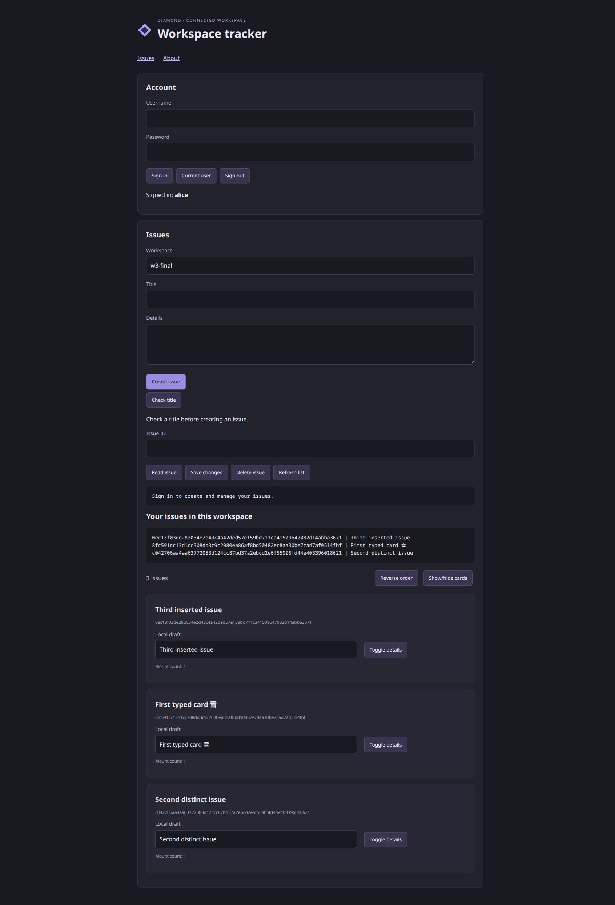

# W3 completion evidence — 22 October 2026

Diamond 0.9.0 implements the [W3 contract](web_three.md) within the bounded
[reactive application profile](../docs/reactive-apps.md). W4–W10 remain planned;
this is not production qualification or a whole-codebase security audit.

The qualified debug executable SHA-256 is
`2adc6d9894d66c80c089245a678fa238cd1d0a3342b431bbacfb3f5f97abff45`;
the library is
`bed5869fb0c49e8e8c32860a543ab8a9e17383abf35acc115b156863574250e7`.
The final receipts pin these actual bytes. Browser, native, raw HTTP and SQL
checks are separate evidence. PostgreSQL, users and listeners were isolated
local fixtures, with two real application processes and a forwarding proxy.
The proxy's timing gates hold completed server replies; they do not supply
application answers, mock storage, or implement browser behavior.

## Observed behavior

| Evidence | Result and scope |
| --- | --- |
| [Independent qualification](web_three_independent_results.json) | 185 generated CLI semantic cases using an independent Decimal/Unicode/list oracle; 30 check/build controls; 121 real HTTP/PostgreSQL/artifact observations; three exact saved CLI regressions; five native public-API checks; 184 exact native corpus values. Drivers and inputs are retained under [w3_independent](w3_independent/README.md). |
| [Actual Chrome](web_three_browser_results.json) | All 184 labeled values match the independent expected output exactly: SHA-256 `91349f24c66b6d67016891d48ea66b04d0124654917bb5dc963505222278cda4`. Eight explicit failure controls retain the old answer/local state; the following valid event clears the error and updates once. |
| Same actual Chrome receipt | All 15 independent composed-event actions match the separate action oracle: pure helper around RPC, nested remote arguments, lazy Match/Boolean, sequential lists/For, empty For, nested loop arguments, ordered assignments, later failure discarding proposed local number 41, and recovery. Local DataError text stays exact; remote Message detail is redacted to `Application failed.`. |
| Same actual Chrome receipt | Required-empty form prevented submission; a valid submit increments once. Textarea Unicode/hostile literal text, checkbox and select bindings agree with output; reactive edits preserve focus. Initial textarea leading LF, selected option and checked state survive SSR/hydration. |
| Same actual Chrome receipt | Typed cards preserve unsaved drafts, expansion and mount count 1 across reverse/insertion. Hide removes all cards; remount resets local drafts/expansion and mounts once. Collision-prone text keys `a/1` and `a` retain independent nested counters after reorder. |
| Same actual Chrome receipt | About link, back/forward and direct reload hydrate successfully; mount count remains 1 per instance. Parent reply after a newer request, child reply after a property change, and reply after unmount cannot overwrite the current generation. Controlled incompatible HTML contract/structure both reject hydration; clearing the fault and reloading recovers. |
| Same actual Chrome receipt | Initial CR/LF/NUL text and title attribute both restore exact code points `[13,10,65,13,66,0]` after parsing/adoption. Expected failure controls log errors; the final normal tracker journey separately records zero new warning/error. |
| [Independent PostgreSQL readback](web_three_postgres_results.json) | Exactly three browser-created records, correct distinct titles, workspace and alice ownership; trace shows real create dispatch on node B and other reads on A. Held/released responses and fixture source fingerprints are retained without credentials. |
| [Navigation failure replay](web_three_navigation_results.json) | Failed route initialization preserves the last successful URL/DOM with a visible error. Correcting the prop permits navigation; a failing forward-history destination also restores the prior route. The original uncaught failure is retained separately. |
| [Frontend boundary replay](web_three_frontend_boundaries.json) | Six actual CLI/build checks: static/dynamic reserved IDs, valid ID control, stylesheet extension restriction, unreachable route exclusion, and NUL SSR encoding. |
| [W1 integration](web_three_web_one_results.json) and [module/artifact replay](web_three_modules_results.json) | Actual W1 CLI/build/HTTP/PostgreSQL behavior preserved; 106 CLI invocations and 112 module/artifact/regression observations pass. |
| [W2 campaign](web_three_web_two_results.json) | Two-node session/ownership CRUD, generated raw SQL comparisons, origin/CSRF/cookie/contract denial, shared expiry/logout/counters, interrupted delivery and unknown commit outcomes retain their documented behavior. |
| [Independent W2 replay](web_three_w2_independent_results.json) | Versioned W3 profile retains 197 HTTP/SQL, 14 CLI and three transitive-effect cases. Browser import mutation is asserted to apply; wire-safe record acceptance is an explicit W3 change. The [original harness mismatch](regressions/w3_w2_driver_before.json) is retained, not labeled a product vulnerability. |
| [Fresh bounded red-team compatibility](web_three_red_team.json), seed `0xD1A09327` | Existing compiler/policy/transport/account/session campaigns pass. Session-flood observations cover the legacy development profile, not W3 distributed production capacity. Dependency advice uses the retained local advisory snapshot, not a fresh feed or proof of total security. |
| [Full compatibility gate](web_three_compatibility_results.json) | Formatting, locked build, strict all-target/all-feature Clippy, compiled public examples, warning-denied rustdoc, native embedding, full checkpoint-five replay, diagnostic exploration, clean installation/startup and performance are pinned in this receipt and its child receipts. |



## Repairs and replay

Actual browser operation found the empty-needle text replacement disagreement,
adjacent-text-node hydration mismatch, native credential-control attribute
normalization, a child property loop's JavaScript temporal-dead-zone failure,
CR/NUL HTML normalization, and uncaught navigation initialization errors. Independent review found incompatible Result
error-type acceptance, generated private type-name access, a conservative text
replacement size check rejecting valid shrinking outputs, incomplete redacted
DataError decoding, and ambiguous text keys in component frame paths. Fixes are
in the checker/resolver, shared utilities, wire codec and managed renderer.
Before receipts, exact input cases and actual replay instructions are retained
under [browser regressions](regressions/w3_browser_replays.md) and
[independent findings](w3_independent/README.md). Successful final controls
distinguish correct fixes from blanket rejection.

```sh
cargo build --locked
python3 verification/web_three_independent.py
python3 verification/w3_frontend_boundaries.py
python3 verification/web_one.py --report verification/web_three_web_one_results.json
python3 verification/web_one_modules.py --report verification/web_three_modules_results.json
python3 verification/web_two.py --report verification/web_three_web_two_results.json
python3 verification/web_two_independent.py --profile w3 --report verification/web_three_w2_independent_results.json
python3 verification/red_team.py --seed 0xD1A09327 --report verification/web_three_red_team.json
python3 verification/checkpoint_six.py --full --output-dir verification/web_three_compatibility --report verification/web_three_compatibility_results.json
python3 verification/web_three.py --serve-fixture /tmp/diamond-w3-replay
```

The last command starts actual browser fixtures; operate Chrome separately using
the retained action tables and [replay instructions](regressions/w3_browser_replays.md).
If browser controls block a local page, the user must open/allow it. Backend
checks are never substituted for blocked UI checks. Historical W1/W2 receipts
remain unchanged; each compatibility run writes a new W3 destination.

## Inspection and remaining limits

Inspection followed changed callers through parsing/type checking, nominal
qualification/visibility, reachability pruning, pure evaluation and budgets,
async expression lowering, managed browser values, keyed DOM lifecycle,
SSR/hydration/routing, asset and map generation, strict wire decoding, RPC
dispatch and transaction outcomes. Independent work emphasized value oracles,
malformed wire/authority boundaries, raw SQL and native public consumers.
This is focused coverage of W3 and affected existing paths, not an all-file audit.

No dependency was added; Rust 1.96 remains the MSRV. New public APIs/errors have
compiled examples. No authored unsafe or lint allowance was added; Miri does not
apply to authored unsafe here. Artifacts move to language 0.9.0/wire version 2;
rebuild trusted source into a fresh destination. Sealed checked programs and
rechecked deterministic build loading remain intact.

Source maps identify pure-function entry wrappers, not every expression/event.
Assets are bounded UTF-8 CSS/SVG/txt; binary assets are deferred. Hydration is
full-page deterministic public content; streaming/authenticated SSR is deferred.
The browser has step/depth/weighted-value limits, not process isolation. Browser
back-forward cache suspension is implemented but not forced/qualified as a
separate browser-cache eviction schedule. Multi-node tests share local PostgreSQL
and do not establish multi-host deployment, arbitrary clock/fault schedules,
capacity or physical durability. Existing coarse locking, bounded document rows,
loopback/Unix-socket grants and explicit provisioned accounts remain. W4 starts
relational data/authorization; pools/migrations, full accounts, uploads, external
integrations, jobs, events and production deployment belong to later checkpoints.
