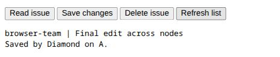

# W2 completion evidence — 21 October 2026

Diamond 0.8.0 completes the connected development slice in the
[W2 acceptance contract](web_two.md). The [guide](../docs/connected-apps.md)
describes its commands, supported semantics and limits. W3–W10 and the complete
general-web release gates remain unfinished.

The final debug executable SHA-256 is
`da4b6b3e0fb8d6461879c708dd79fa61869529825425d426157650a63edfd3c4`.
All final receipts below identify that executable. The
[final source manifest](web_two_final_state.json) confirms that crate sources and
Cargo manifests match the full compatibility gate and records later documentation,
consumer and replay-driver changes. PostgreSQL, accounts,
listeners and proxy instances were isolated local test resources. The runtime
and the application were exercised through actual interfaces, without mocked
storage, fabricated pages or replacement business handlers.

## Observations

| Evidence | Observed result |
| --- | --- |
| [Two-node campaign](web_two_results.json) | Login A, create B, read/edit A, restart B, read the same record/session through B. Bob and anonymous read/edit/delete denials left independent PostgreSQL observations unchanged. |
| Same generated campaign, seed `0xD1A08202` | 145 recorded cases, 18 generated records compared independently with raw SQL, eight concurrent atomic updates, canonical Int64/Bool/Text values and rejections, Unicode/injection/bounds, private dispatch, origin/CSRF/cookie/contract forgery, shared expiry/logout and cross-node login counters. |
| Same campaign, controlled delivery fault | A native fixture-only gate blocked an actual insert. The HTTP client disconnected; releasing the gate produced exactly one committed record readable through the other node. Owned work was not discarded with delivery. |
| Same campaign, controlled commit fault | A real deferred PostgreSQL failure occurred at COMMIT. HTTP returned 503 `outcome_unknown`; an independent SQL count established no new row in that fixture. No automatic replay occurred; a subsequent request recovered. |
| [Independent verifier](web_two_independent_results.json), seed `0x22C0DE` | 197 HTTP/SQL observations, 14 CLI boundary/contract cases and three transitive effect-budget cases passed. The retained portable drivers were replayed after path/exit-code adjustments. |
| [Actual Chrome journey](web_two_browser_results.json) | Bound inputs, Alice login, creation/read/edit, literal hostile text, Bob account switch with cleared fields, denied Alice-ID read, Alice recovery, browser reload with shared session/data, owned listing, deletion and logout. SQL independently confirmed owner/content before deletion and zero matching rows afterward. No console error/warning was observed in the final journey. |
| [Native consumer](web_two_native_results.json) | `cargo run --locked --example connected_embedding` initialized the actual profile and provisioned an account via the public library API; independent SQL confirmed its Argon2id account record. |
| [Full legacy compatibility](web_two_compatibility_results.json) | Formatting, locked build, strict all-target/all-feature Clippy, 19 doctests, warning-denied rustdoc, native embedding, full checkpoint-five replay, diagnostic exploration, clean installation/startup and performance passed. |
| [W1 integration](web_two_w1_results.json) and [module/artifact exploration](web_two_w1_modules_results.json) | Existing W1 CLI/build/HTTP/PostgreSQL profile passed; 106 module CLI cases, five artifact observations and seven saved resolver replays passed. |
| [W1 actual Chrome](web_two_w1_browser_results.json) | All 33 observed scalar values matched the independent generator; overflow preserved count 2 and exposed the error; the next click produced 5 and cleared it. |
| [Fresh-seed red-team compatibility](web_two_red_team.json), `0xD1A08267` | Existing language/compiler/transport/policy/account/session campaigns passed on this executable, including valid-session checks after 8,194 anonymous requests. These are compatibility-profile findings, not a W2 session-saturation claim. |

The browser initially blocked agent-created navigation. The user opened the
permitted local page, and the agent attached to that live tab before operating
the actual controls. Backend checks were not presented as browser evidence.



## Repaired findings

- [PostgreSQL binding](regressions/w2_postgres_binding/README.md): the first create
  failed because a text parameter was bound directly to a JSON-typed placeholder.
  Explicit text casting fixes the binding; backend failures retain their opaque
  runtime class rather than becoming user-input Results.
- [Unicode storage](regressions/w2_unicode_storage/README.md): independent testing
  reproduced valid NUL text failing JSONB storage. The JSON profile preserves it;
  fresh HTTP and raw SQL readback match exactly. Pre-fix and final receipts remain.
- [Browser CSP](regressions/w2_browser_connect/README.md): actual sign-in exposed
  missing same-origin fetch permission. Connected HTML now declares
  `connect-src 'self'`; both real browser and independent header checks pass.
- [Account-switch state](regressions/w2_account_switch/README.md): actual Bob
  sign-in retained Alice's previous local fields. Diamond handlers now clear
  account-specific state on successful identity changes; the browser replay
  verifies clearing and denied cross-account reads.

## Inspection, packaging and boundaries

Inspection covered project parsing/resolution/budgets, RPC signature selection,
wire decoding, browser lowering/emission/bindings, connected transport and its
callers, shared identity/session queries, PostgreSQL operations/transaction
completion, and changes in the reference checker/evaluator. The PostgreSQL path
reuses checked policies and input validation while the SQLite adapter retains
its original relation-validation contract. Independent inspection concentrated
on RPC/wire/auth/visibility boundaries and raw reproductions. This is not an
all-file codebase audit or proof of total security.

The package moves from 0.7.0 to 0.8.0 for additive public project setup/serving APIs
and the opaque `Error::Postgres` variant. Rust 1.96 remains the MSRV and was the
qualification toolchain. New public API docs compile; the native consumer ran.
No dependency was added by W2. No authored unsafe or lint allowance was added;
Miri is inapplicable to authored unsafe here. The advisory replay found no listed
vulnerability among 147 dependencies against its local 1,348-entry database;
that snapshot is not a fresh advisory-feed or total-security guarantee.

W2 is a scalar RPC and single-component development profile: coarse application
locking, bounded JSON document rows, explicit account provisioning, local Unix
PostgreSQL and loopback serving. It does not provide W3's full language/frontend,
W4's relational schemas/query planning/relationships/pools/migrations, W5's full
account/API lifecycle, or later storage/integration/jobs/events/deployment work.
Production connection admission, OS isolation, multi-host deployment, exhaustive
clock/capacity/fault schedules and physical durability were not qualified.

## Replay

```sh
cargo build --locked
python3 verification/web_two.py
python3 verification/web_two_independent.py
python3 verification/regressions/w2_unicode_storage/replay.py
python3 verification/web_one.py --report verification/web_two_w1_results.json
python3 verification/web_one_modules.py --report verification/web_two_w1_modules_results.json
python3 verification/red_team.py --seed 0xD1A08267 --report verification/web_two_red_team.json
```

Socket permission and installed PostgreSQL tools are required. The browser
fixture and manual replay actions are described in the connected guide and
retained regressions. Temporary services were stopped after verification.
